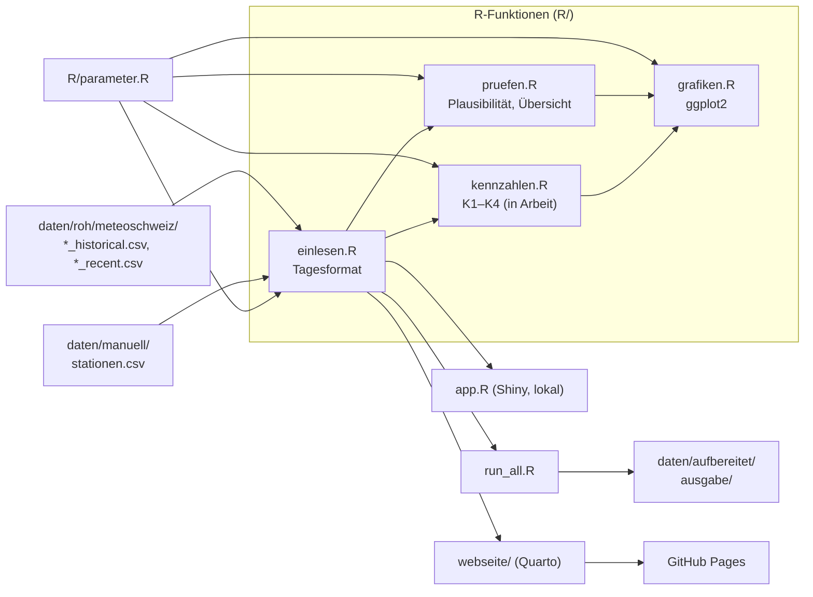
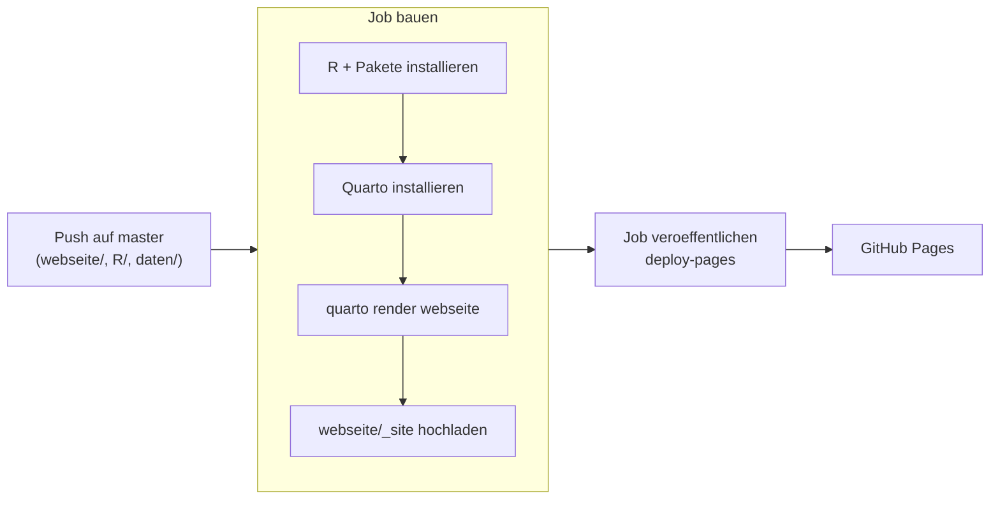

# Technische Dokumentation

Auswertungsprogramm «Ski ohne Schnee?»
Stand: 25.11.2026 · Gilt für den Stand von `master`

Diese Dokumentation beschreibt, wie das Programm aufgebaut ist und
funktioniert. *Was* es berechnen muss (Kennzahlen, Rechenregeln,
Testfälle), steht in der Anforderungsanalyse
[anforderungen.md](anforderungen.md). Bei Widersprüchen gilt die
Anforderungsanalyse.

## Inhalt

1. [Überblick](#1-überblick)
2. [Randbedingungen](#2-randbedingungen)
3. [Aufbau und Datenfluss](#3-aufbau-und-datenfluss)
4. [Module und Funktionen](#4-module-und-funktionen)
5. [Datenmodell](#5-datenmodell)
6. [Parameter](#6-parameter)
7. [Datenqualität](#7-datenqualität)
8. [Ausgaben](#8-ausgaben)
9. [Webseite](#9-webseite)
10. [Tests](#10-tests)
11. [Architekturentscheide](#11-architekturentscheide)
12. [Betrieb und Wartung](#12-betrieb-und-wartung)
13. [Offene Punkte](#13-offene-punkte)

## 1 Überblick

Das Programm ist eine Skript-Pipeline in R. Es liest tägliche Schneehöhen,
prüft sie, berechnet Kennzahlen pro Station und Winter und schreibt Tabellen
und Grafiken. Zwei Oberflächen zeigen die Resultate an, ohne selbst zu
rechnen:

- eine **statische Webseite** (Quarto), öffentlich auf GitHub Pages
- eine **lokale Shiny-App** (`app.R`) zum Ausprobieren

Ziele und Fragestellung: siehe [README](../README.md#ziele).

## 2 Randbedingungen

| Bereich | Vorgabe |
|---|---|
| Sprache | R; Funktionsnamen, Kommentare und Beschriftungen auf Deutsch (Schweizer Rechtschreibung) |
| Pakete | readr, dplyr, tidyr, lubridate, ggplot2, zoo, trend, testthat, shiny, knitr, rmarkdown; weitere nur nach Absprache |
| Rohdaten | `daten/roh/` wird nie verändert |
| Fehlende Werte | immer `NA`, nie 0 |
| Feste Werte | keine im Code; alles in `R/parameter.R` |
| Auffällige Daten | werden gemeldet, nicht korrigiert |
| Fehler | fehlende Datei, unbekannte Station, falsches Format führen zu einer klaren Fehlermeldung |
| JavaScript | nur Observable JS in `webseite/interaktiv.qmd`, nur zum Filtern und Zeichnen |
| Rollen | K1 bis K4 schreibt das Team selbst (siehe [CLAUDE.md](../CLAUDE.md)) |

## 3 Aufbau und Datenfluss

Alle drei Wege (`run_all.R`, Webseite, App) verwenden **dieselben
Funktionen** aus `R/`. Damit stimmen die Resultate überall überein.

**Ablauf beim Einlesen einer Station** (`lies_station_meteoschweiz`):

1. Dateien «historical» und «recent» lesen, Spalten prüfen, Schneehöhe aus
   der Spalte `hto000d0` übernehmen
2. Tage, die in beiden Dateien vorkommen, nur einmal behalten
   (`entferne_doppelte_tage`)
3. Tage vor dem ersten Schneehöhen-Wert weglassen (`ab_messbeginn`)
4. Kalendertage, die ganz fehlen, als `NA` ergänzen
   (`ergaenze_fehlende_tage`)

## 4 Module und Funktionen

Jede Funktion hat im Code einen Kommentarkopf mit Zweck, Eingabe und
Ausgabe. Diese Tabelle gibt den Überblick.

### R/einlesen.R

| Funktion | Zweck |
|---|---|
| `pruefe_spalten(tabelle, spalten, herkunft)` | bricht mit klarer Meldung ab, wenn eine Spalte fehlt (TC-14) |
| `lies_stationen(pfad)` | liest `stationen.csv` und prüft die Felder |
| `lies_meteoschweiz_datei(pfad, spalte_hs)` | liest eine Rohdatei ins Tagesformat |
| `entferne_doppelte_tage(tage)` | behält doppelte Tage einmal; warnt bei verschiedenen Werten |
| `ab_messbeginn(tage)` | lässt Tage vor dem ersten Schneehöhen-Wert weg und meldet ihre Zahl |
| `ergaenze_fehlende_tage(tage)` | ergänzt ganz fehlende Kalendertage als `NA` |
| `lies_station_meteoschweiz(station_id, ordner, parameter)` | liest und vereinheitlicht alle Dateien einer Station |
| `lies_alle_stationen(stationen, ordner, parameter)` | liest alle Stationen der Stationsliste |

### R/pruefen.R

| Funktion | Zweck |
|---|---|
| `pruefe_tageswerte(tage, obergrenze_cm, sprung_cm)` | meldet negative Werte, Werte über der Obergrenze, Tagessprünge und doppelte Tage |
| `datenuebersicht(tage, monate)` | zählt pro Station und Kalenderjahr Tage mit und ohne Messwert (Dezember bis April) |

### R/grafiken.R

| Funktion | Zweck |
|---|---|
| `zeichne_schneehoehenreihe(tage_station, titel, achsenabstand)` | ganze Schneehöhenreihe einer Station, Lücken als orange Striche |
| `zeichne_datenluecken(uebersicht, titel)` | Balken der Tage ohne Messwert pro Jahr |

### R/kennzahlen.R

Kommentarköpfe für K1 bis K4 (`zaehle_schneetage`,
`berechne_vollstaendigkeit`, `ist_schneesicher`, `hundert_tage_regel`).
Die Funktionen schreibt das Team; die Tests TC-01 bis TC-10 stehen bereit.

| Funktion | Zweck |
|---|---|
| `hoehenklasse(hoehe_m, grenzen, namen)` | teilt Stationshöhen in Höhenklassen ein (FA-14); genau 1500 m und genau 2000 m gehören zu «1500 bis 2000 m» |

### R/statistik.R

| Funktion | Zweck |
|---|---|
| `trendtest(werte, parameter)` | Mann-Kendall-Test mit Bindungskorrektur und Sen-Steigung mit dem Paket `trend` (K7, FA-16); Ausgabe n, S, Var(S), Z, p-Wert, Steigung pro Winter und pro Jahrzehnt, signifikant, Hinweis. Reihe ohne Veränderung: «kein Trend berechenbar» (TC-12). Reihe mit `NA`, unter 3 Werten oder Text: Fehler |

### R/parameter.R

Benannte Liste `parameter` mit allen Einstellungen (siehe Kapitel 6).

### Startskripte

| Datei | Zweck |
|---|---|
| `run_all.R` | ganze Auswertung: einlesen, prüfen, Übersicht und Kontrollgrafiken schreiben |
| `app.R` | lokale Shiny-App: Station und Zeitraum wählen, Grafik, Lücken, Auffälligkeiten |

## 5 Datenmodell

### Einheitliches Tagesformat

Ergebnis des Einlesens, Eingabe für alle weiteren Schritte. Ein Tag pro
Station und Zeile, lückenlos ab Messbeginn.

| Spalte | Typ | Bedeutung |
|---|---|---|
| `station_id` | Text | Schlüssel zu `stationen.csv` |
| `datum` | Date | Kalendertag |
| `hs_cm` | Zahl | Schneehöhe in cm; fehlend = `NA` |
| `quelle` | Text | `"MeteoSchweiz"` oder `"SLF"` |

### Stationsliste `daten/manuell/stationen.csv`

Trennzeichen Strichpunkt, UTF-8. Felder gemäss
[anforderungen.md](anforderungen.md), Tabelle 1: `gebiet`, `bergbahn`,
`region`, `station_id`, `station_name`, `quelle`, `hoehe_station_m`,
`hoehe_tal_m`, `hoehe_berg_m`, `distanz_km`, `bemerkung`.
Nicht belegte Felder bleiben leer.

### Rohdaten MeteoSchweiz

- Dateiname: `ogd-nime_<kürzel>_d_<teil>.csv` mit `<teil>` = `historical`
  (Messbeginn bis 31.12. des Vorjahrs) oder `recent` (ab 1.1.)
- Trennzeichen Strichpunkt; Datum in `reference_timestamp`
- Schneehöhe: Parameter `hto000d0` («Schneehöhe; Morgenmessung von 6 UTC»,
  cm) gemäss `daten/roh/meteoschweiz/meta/ogd-nime_meta_parameters.csv`
- Herkunft und Bezugsdatum: [daten/roh/QUELLEN.md](../daten/roh/QUELLEN.md)

## 6 Parameter

Alle Werte in [R/parameter.R](../R/parameter.R). Im Code steht
`parameter$<name>`, nie die Zahl selbst.

| Name | Wert | Bedeutung |
|---|---|---|
| `schwellenwert_cm` | 30 | ab dieser Schneehöhe ist ein Tag ein Schneetag |
| `saison_beginn_monat`, `saison_beginn_tag` | 12, 1 | Saisonbeginn 1. Dezember |
| `saison_ende_monat`, `saison_ende_tag` | 4, 15 | Saisonende 15. April |
| `start_winter` | 1971 | erster Winter (Winter = Jahr des Januars) |
| `min_schneetage` | 100 | schneesicherer Winter |
| `regel_winter`, `regel_fenster` | 7, 10 | 100-Tage-Regel: 7 von 10 Wintern |
| `min_vollstaendigkeit` | 0.90 | Mindestanteil Tage mit Messwert für einen gültigen Winter |
| `signifikanzniveau` | 0.05 | für Trendtests |
| `hoehenklassen_grenzen`, `hoehenklassen_namen` | 1500, 2000 | unter 1500 m, 1500 bis 2000 m, über 2000 m |
| `ms_spalte_schneehoehe` | `hto000d0` | Spalte der Schneehöhe in den MeteoSchweiz-Dateien |
| `ms_dateimuster`, `ms_teile` | | Dateinamen der Rohdaten |
| `pruef_obergrenze_cm` | 500 | höhere Werte werden gemeldet |
| `pruef_sprung_cm` | 100 | grössere Tagessprünge werden gemeldet |
| `uebersicht_monate` | 12, 1–4 | Monate der Datenübersicht |

## 7 Datenqualität

| Fall | Behandlung | Wo |
|---|---|---|
| Leerer Messwert | `NA` | `lies_meteoschweiz_datei` |
| Text statt Zahl | Fehler | `lies_meteoschweiz_datei` |
| Fehlende Spalte oder Datei | Fehler mit Datei- und Spaltenname | `pruefe_spalten`, `lies_meteoschweiz_datei` |
| Tag in «historical» und «recent» | einmal behalten; Warnung bei verschiedenen Werten | `entferne_doppelte_tage` |
| Tage vor dem Messbeginn | weggelassen und gemeldet; die Dateien beginnen 1878 (Elm) bzw. 1890 (Arosa), die Schneehöhe erst 1949 | `ab_messbeginn` |
| Station ohne Schneehöhe | Fehler | `ab_messbeginn` |
| Ganz fehlender Kalendertag | als `NA` ergänzt | `ergaenze_fehlende_tage` |
| Negativ, zu hoch, grosser Sprung, doppelter Tag | gemeldet in `auffaelligkeiten.csv`, nicht korrigiert | `pruefe_tageswerte` |

Bekannte Besonderheiten der Daten stehen im Feld `bemerkung` der
Stationsliste (z. B. Wechsel des Dateneigners bei Arosa ab 16.12.2015).

## 8 Ausgaben

`run_all.R` schreibt (Ordner sind nicht im Repo, sie lassen sich jederzeit
neu erzeugen):

| Datei | Inhalt |
|---|---|
| `daten/aufbereitet/tageswerte.csv` | Tageswerte aller Stationen im Tagesformat |
| `ausgabe/tabellen/auffaelligkeiten.csv` | Meldungen der Plausibilitätsprüfung |
| `ausgabe/tabellen/datenuebersicht.csv` | Tage mit und ohne Messwert pro Station und Jahr |
| `ausgabe/grafiken/schneehoehe_<id>.png` | Kontrollgrafik der ganzen Reihe pro Station |

## 9 Webseite

### Aufbau

Statische Webseite mit [Quarto](https://quarto.org/). R rechnet beim
**Bauen**; im Browser läuft kein R. Die Seite lädt deshalb schnell.

| Datei | Inhalt |
|---|---|
| `webseite/_quarto.yml` | Menü, Aussehen, SVG als Grafikformat, Fusszeile mit Quellenangabe |
| `webseite/_laden.R` | gemeinsamer Start aller Seiten: Funktionen aus `R/` laden, Daten einlesen |
| `webseite/index.qmd` | Startseite: Zweck, Stationsliste, Stand |
| `webseite/stationen.qmd` | pro Station Registerkarten: Schneehöhe, Datenlücken, Auffälligkeiten (ggplot2 als SVG) |
| `webseite/interaktiv.qmd` | interaktive Grafik: Station, Zeitraum, Tooltip (Observable JS) |
| `webseite/_site/` | gebaute Seite, nicht im Repo |

Neue Stationen erscheinen automatisch, weil die Seiten über
`stationen.csv` laufen.

### Interaktive Grafik

`interaktiv.qmd` übergibt die Tageswerte mit `ojs_define()` von R an
Observable JS. Der JavaScript-Teil filtert nach Station und Zeitraum und
zeichnet mit Observable Plot. Die Bibliotheken Plot, Inputs und d3 lädt der
Browser beim ersten Aufruf von cdn.jsdelivr.net.

### Bauen und Veröffentlichen

- Workflow: [.github/workflows/pages.yml](../.github/workflows/pages.yml)
- Zwei Jobs, weil das Veröffentlichen im selben Job das hochgeladene Paket
  zeitweise nicht fand
- R-Pakete werden zwischengespeichert; ein Lauf dauert rund zweieinhalb
  Minuten
- Voraussetzung im Repo: Settings → Pages → Source «GitHub Actions»

## 10 Tests

Tests mit testthat in `tests/`. `helper-laden.R` lädt die Funktionen und
erzeugt kleine künstliche Testdaten.

| Datei | Inhalt | Stand |
|---|---|---|
| `test-einlesen.R` | TC-14 (fehlende Spalte, Datei, Quelle), `NA` statt 0, Überschneidung, doppelte Tage, Ergänzen fehlender Tage, Messbeginn, Text statt Zahl | 10 von 10 bestehen |
| `test-pruefen.R` | Meldungen der Plausibilitätsprüfung, Datenübersicht | 6 von 6 bestehen |
| `test-kennzahlen.R` | TC-01 bis TC-10 für K1 bis K4; Höhenklassen (FA-14) | TC-01 bis TC-10 schlagen fehl, bis K1 bis K4 geschrieben sind (gewollt); Höhenklassen 2 von 2 bestehen |
| `test-statistik.R` | TC-11, TC-12 (Trendtest), Fehlerfälle | Fehlerfälle bestehen; TC-11 und TC-12 werden übersprungen, wenn das Paket `trend` fehlt (noch auf einem Rechner mit `trend` laufen lassen) |

Ausführen: `Rscript -e "testthat::test_dir('tests')"`

## 11 Architekturentscheide

Kurzform nach dem Muster «Kontext – Entscheid – Folgen».

**AE-01 Skript-Pipeline statt Anwendung.** Das Programm ist ein Werkzeug
der Methode. *Entscheid:* R-Skripte mit einem Startbefehl (`run_all.R`),
keine Datenbank. *Folgen:* einfach nachvollziehbar und erklärbar.

**AE-02 Webseite statisch mit Quarto statt shinylive.** Die erste
Webseite lief mit shinylive (R im Browser) und brauchte 15 bis 20 Sekunden
zum Laden, weil der Browser R und alle Pakete herunterladen und starten
musste. *Entscheid:* statische Quarto-Seite, R rechnet beim Bauen.
*Folgen:* Ladezeit unter 2 Sekunden; freie Parameterwahl nur noch in der
lokalen App.

**AE-03 GitHub Pages statt Vercel.** Vercel kann kein R ausführen und
hätte die fertige Seite im Repo gebraucht. *Entscheid:* GitHub Pages mit
Bauen in GitHub Actions. *Folgen:* nichts Erzeugtes im Repo, Seite immer
aktuell.

**AE-04 Messbeginn beim Einlesen.** Die Rohdateien beginnen Jahrzehnte vor
der Schneemessung. *Entscheid:* `ab_messbeginn()` beim Einlesen, mit
Meldung. *Folgen:* Lückenstatistik und später K2 zählen nur echte Lücken;
gilt für alle Ausgaben gleich.

**AE-05 JavaScript nur zum Anzeigen.** Für Zoom und Filter braucht es
Interaktivität im Browser. *Entscheid:* Observable JS nur in
`interaktiv.qmd`, nur filtern und zeichnen. *Folgen:* Rechnungen bleiben in
R und testbar; die interaktive Grafik sieht etwas anders aus als die
ggplot2-Grafiken.

## 12 Betrieb und Wartung

| Aufgabe | Vorgehen |
|---|---|
| Station hinzufügen | Zeile in `stationen.csv`, Rohdateien nach `daten/roh/meteoschweiz/`, Quelle in `QUELLEN.md`; pushen |
| Daten aktualisieren | neue «recent»-Datei herunterladen, Bezugsdatum in `QUELLEN.md` nachführen; pushen |
| Parameter ändern | Wert in `R/parameter.R`; Tests laufen lassen |
| Neue Webseiten-Seite | `webseite/<name>.qmd` mit `source("_laden.R")` anlegen und in `_quarto.yml` unter `navbar` eintragen |
| Webseite lokal prüfen | `quarto preview webseite` |
| Fehlgeschlagener Pages-Lauf | unter «Actions» den Lauf öffnen; bei «No artifacts named github-pages» erneut starten |

**Dokumentation nachführen:** Jede Änderung an Funktionen, Parametern,
Ausgaben, Webseite oder Workflow wird im selben Arbeitsschritt in dieser
Datei und, falls betroffen, im [README](../README.md) nachgeführt.

## 13 Offene Punkte

| Punkt | Bezug |
|---|---|
| K1 bis K4 schreiben (Team) | AP4, TC-01 bis TC-10 |
| SLF-Daten: Format, Zugang, Lizenz; Einlesefunktion | E2, FA-02 |
| Behandlung ungültiger Winter im Zehnjahresfenster | E5 |
| Definition Weihnachtstage | E6 |
| Februar oder April als Vergleichsfenster zum Dezember | E11 |
| Quellenangabe SLF für Arosa ab 16.12.2015 | QUELLEN.md |
| Lizenz für den eigenen Code | – |
| Umgang mit ungültigen Wintern in der Trendreihe: `trendtest` verlangt eine lückenlose Reihe; das Paket `trend` rechnet die Sen-Steigung mit gleichen Abständen. Weglassen verzerrt die Abstände, darum vorerst Fehlermeldung | K7, FA-16, E5 |
| TC-11 und TC-12 auf einem Rechner mit Paket `trend` laufen lassen | FA-16 |
| Zuordnung genau 2000 m: zu «1500 bis 2000 m» (Wortlaut FA-14 «1500 bis 2000 m», «über 2000 m»); bestätigen | FA-14 |
